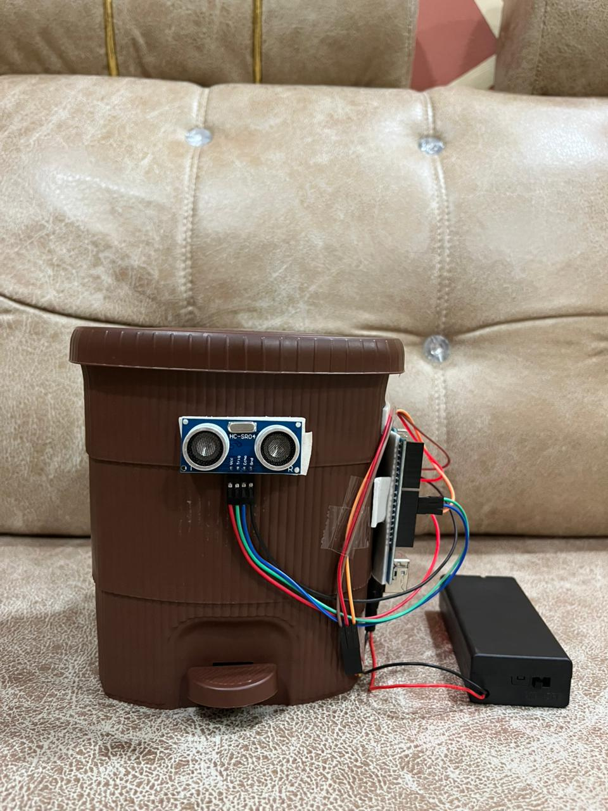
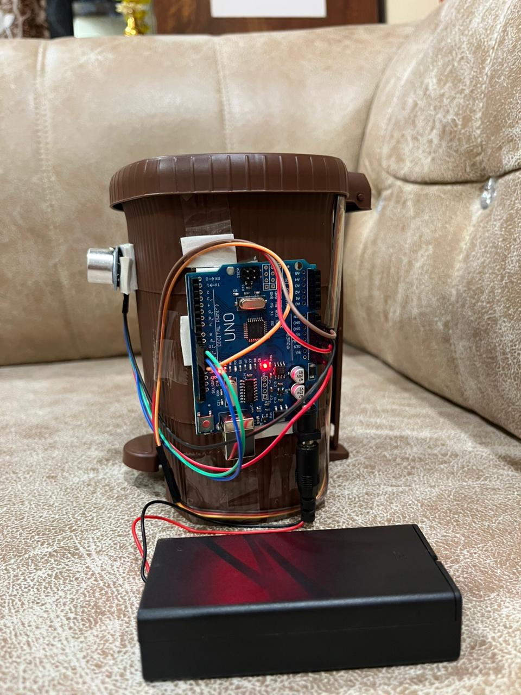
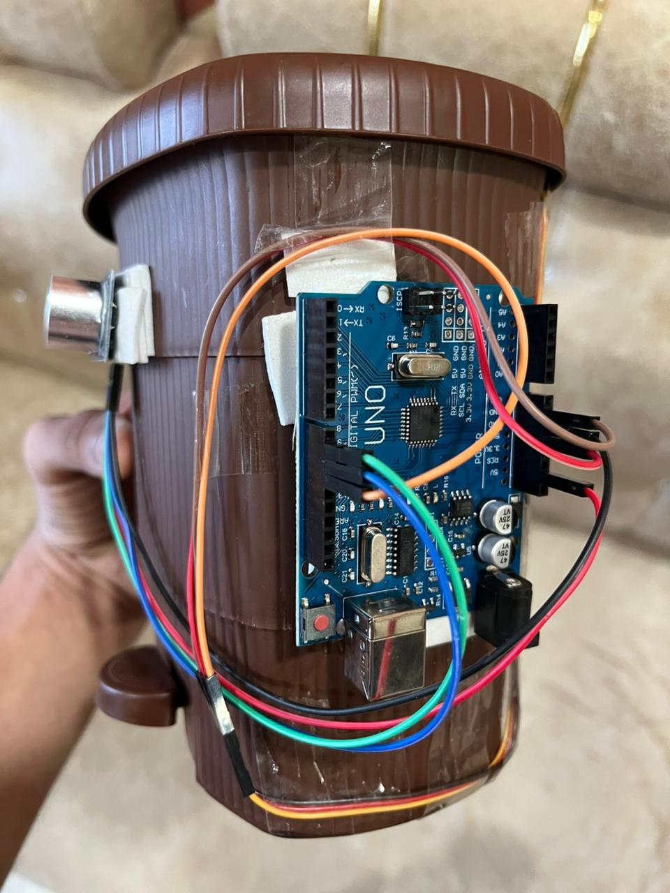

# 🗑️ Automatic Dustbin Using Arduino

## 📌 About the Project

The Automatic Dustbin is an Arduino-based smart waste disposal system that automatically opens and closes its lid when an object or hand is detected nearby.

It uses an HC-SR04 ultrasonic sensor to measure the distance of an object and a servo motor to control the dustbin lid. The system provides a contactless waste disposal solution that improves hygiene and user convenience.

## 🛠️ Technologies & Components Used

- Arduino Uno
- HC-SR04 Ultrasonic Sensor
- Servo Motor
- Embedded C
- Arduino IDE
- Jumper Wires
- Power Supply

## ✨ Features

- Automatic lid opening and closing.
- Contactless waste disposal.
- Real-time object distance detection.
- Ultrasonic sensor-based operation.
- Servo motor-controlled lid movement.
- Automatic operation without manual contact.

## ⚙️ Working Principle

1. The HC-SR04 ultrasonic sensor continuously measures the distance of nearby objects.
2. When an object is detected within 20 cm, the Arduino processes the sensor reading.
3. The servo motor rotates to 90 degrees to open the dustbin lid.
4. When no object is detected within the specified range, the servo motor returns to 0 degrees and closes the lid.

## 🔌 Pin Connections

| Component | Arduino Pin |
|---|---|
| Ultrasonic Trigger | 9 |
| Ultrasonic Echo | 10 |
| Servo Motor Signal | 11 |
| VCC | 5V |
| GND | GND |

## 📸 Project Images

### Front View

### Back View

### Arduino Connections

## 🎥 Project Demonstration

[▶️ Watch Automatic Dustbin Project Demo](Video Project 1.mp4)

## 💻 Source Code

The project is programmed using Embedded C in Arduino IDE.

The program uses:
- `Servo.h` library to control the servo motor.
- `pulseIn()` to measure the ultrasonic sensor response.
- `digitalWrite()` to trigger ultrasonic measurements.
- `servo.write()` to control the dustbin lid.

## 🚀 How to Run the Project

1. Install Arduino IDE.
2. Connect the HC-SR04 ultrasonic sensor to Arduino Uno.
3. Connect the servo motor to the Arduino.
4. Upload the project source code (`dustbin code.txt`).
5. Power the Arduino.
6. Place your hand near the ultrasonic sensor to test automatic lid operation.

## 🎯 Learning Outcomes

- Understanding Arduino and embedded systems.
- Working with ultrasonic sensors.
- Controlling servo motors.
- Understanding sensor-based automation.
- Implementing real-time object detection.

## 👩‍💻 Author

**Sakshi Shimpi**

- GitHub: [sakshishimpi03](https://github.com/sakshishimpi03)
- LinkedIn: [sakshi-shimpi](https://linkedin.com/in/sakshi-shimpi)

---
